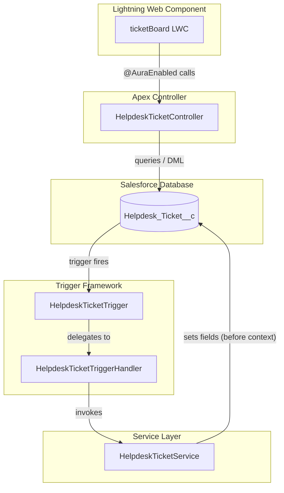
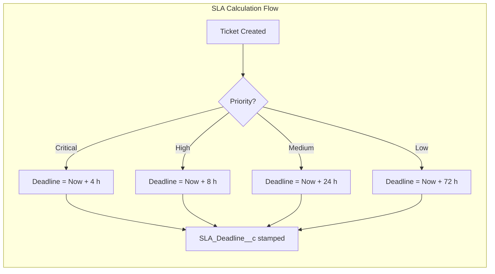

<p align="center">
  
  
  
  
  
</p>

# 🎫 Helpdesk Inteligente — Sistema de Gestão de Chamados e SLA

> **Intelligent Helpdesk — Ticket & SLA Management System**

A full-stack Salesforce DX project demonstrating enterprise-grade patterns for **ticket lifecycle management**, **automatic SLA calculation**, and a polished **Lightning Web Component** dashboard — built to showcase real-world best practices for a professional portfolio.

---

## 📋 Table of Contents

- [Business Problem](#-business-problem)
- [Solution Overview](#-solution-overview)
- [Architecture](#-architecture)
- [Tech Stack](#-tech-stack)
- [Project Structure](#-project-structure)
- [Key Features](#-key-features)
- [SLA Rules](#-sla-rules)
- [Screenshots / Demo](#-screenshots--demo)
- [Getting Started](#-getting-started)
- [Running Tests](#-running-tests)
- [Author](#-author)

---

## 🎯 Business Problem

Support teams often struggle with:

- **No visibility** into ticket aging and SLA compliance.
- **Manual tracking** of deadlines, leading to missed SLAs and unhappy customers.
- **Scattered data** without a centralized, filterable dashboard for agents and managers.

**This project solves these pain points** by automating SLA deadlines based on ticket priority and providing a real-time visual dashboard with SLA-at-risk alerts.

---

## 💡 Solution Overview

| Layer | What it does |
|-------|-------------|
| **Custom Object** | `Helpdesk_Ticket__c` with auto-numbered ticket IDs, picklist-driven status/priority, and SLA tracking fields. |
| **Apex Trigger + Handler** | Single trigger per object, zero in-trigger logic — delegates to a handler following the **Trigger Handler pattern**. |
| **Apex Service Layer** | `HelpdeskTicketService` encapsulates all business rules (SLA calculation, violation checks) — reusable from triggers, controllers, or batch jobs. |
| **Apex Controller** | `@AuraEnabled` methods with `AuraHandledException` wrapping — feeds the LWC with filtered queries and dashboard metrics. |
| **LWC Dashboard** | `ticketBoard` — interactive card grid with filters, SLA badges, violation alerts, and quick status-change actions with toast feedback. |
| **Test Coverage** | `HelpdeskTicketTest` + `TestDataFactory` — 15+ test methods covering success, error, edge-case and **bulk (200+)** scenarios. Target: **95 %+ coverage**. |

---

## 🏗 Architecture





---

## 🛠 Tech Stack

| Technology | Purpose |
|-----------|---------|
| **Salesforce DX (SFDX)** | Source-driven development & scratch org management |
| **Apex** | Server-side logic — triggers, services, controllers, tests |
| **LWC** | Modern UI framework with reactive data binding |
| **SLDS** | Salesforce Lightning Design System for consistent, accessible UI |
| **Salesforce CLI (`sf`)** | Project scaffolding, deployment, test execution |

---

## 📁 Project Structure

```
sfdx-helpdesk-sla/
├── config/
│   └── project-scratch-def.json
├── force-app/main/default/
│   ├── classes/
│   │   ├── HelpdeskTicketController.cls
│   │   ├── HelpdeskTicketService.cls
│   │   ├── HelpdeskTicketTest.cls
│   │   ├── HelpdeskTicketTriggerHandler.cls
│   │   └── TestDataFactory.cls
│   ├── lwc/
│   │   └── ticketBoard/
│   │       ├── ticketBoard.html
│   │       ├── ticketBoard.js
│   │       ├── ticketBoard.css
│   │       └── ticketBoard.js-meta.xml
│   ├── objects/
│   │   └── Helpdesk_Ticket__c/
│   │       ├── Helpdesk_Ticket__c.object-meta.xml
│   │       └── fields/
│   │           ├── Title__c.field-meta.xml
│   │           ├── Description__c.field-meta.xml
│   │           ├── Status__c.field-meta.xml
│   │           ├── Priority__c.field-meta.xml
│   │           ├── SLA_Deadline__c.field-meta.xml
│   │           ├── SLA_Violated__c.field-meta.xml
│   │           └── Assigned_Agent__c.field-meta.xml
│   └── triggers/
│       └── HelpdeskTicketTrigger.trigger
├── .gitignore
├── sfdx-project.json
└── README.md
```

---

## ✨ Key Features

### Backend (Apex)
- ✅ **Clean Trigger pattern** — one trigger per object, handler + service separation.
- ✅ **Automatic SLA calculation** on insert based on priority.
- ✅ **SLA recalculation** when priority changes on existing tickets.
- ✅ **SLA violation detection** on every update (stamps `SLA_Violated__c = true`).
- ✅ **`AuraHandledException`** wrapping in all controller methods.
- ✅ **Bulk-safe** — tested with 200+ records, no governor limit issues.

### Frontend (LWC)
- 🖥 **Dashboard metrics** — Total / Open / Resolved / SLA Violated counters.
- 🔍 **Live search** with debounced text input.
- 🎛 **Combo filters** for Status and Priority.
- 🏷 **Color-coded badges** for priority (Low → Critical) and status.
- 🚨 **Visual SLA alerts** — red border for violated, orange for at-risk (< 2 h).
- ⚡ **Quick status change** via dropdown on each card with Toast notification.
- ⏳ **Loading spinner** and **empty state** handling.

---

## ⏱ SLA Rules

| Priority | SLA Deadline |
|----------|-------------|
| **Critical** | 4 hours from creation |
| **High** | 8 hours from creation |
| **Medium** | 24 hours from creation |
| **Low** | 72 hours from creation |

> When a ticket's priority is changed, the SLA deadline is **recalculated** from the original `CreatedDate`.

---

## 📸 Screenshots / Demo

> **📌 Replace the placeholders below with actual screenshots of your scratch org.**

| Dashboard Overview | Ticket Card with SLA Alert |
|--------------------|---------------------------|
|  |  |

| Filters in Action | Toast Notification |
|-------------------|--------------------|
|  |  |

---

## 🚀 Getting Started

### Prerequisites

- [Salesforce CLI (`sf`)](https://developer.salesforce.com/tools/salesforcecli) installed.
- A Salesforce **Dev Hub** org enabled.
- Git installed.

### Step-by-step Deploy

```bash
# 1. Clone the repository
git clone https://github.com/<YOUR_USERNAME>/sfdx-helpdesk-sla.git
cd sfdx-helpdesk-sla

# 2. Authenticate your Dev Hub
sf org login web --set-default-dev-hub --alias devhub

# 3. Create a Scratch Org
sf org create scratch --definition-file config/project-scratch-def.json --alias helpdesk --duration-days 30 --set-default

# 4. Deploy source to the Scratch Org
sf project deploy start --target-org helpdesk

# 5. Assign a permission set (if applicable)
# sf org assign permset --name Helpdesk_Admin --target-org helpdesk

# 6. Open the org
sf org open --target-org helpdesk
```

### Deploy to a Sandbox or Production

```bash
# Authenticate target org
sf org login web --alias myorg

# Deploy
sf project deploy start --target-org myorg

# Validate (check-only deploy)
sf project deploy start --target-org myorg --dry-run
```

---

## 🧪 Running Tests

```bash
# Run all tests with code coverage
sf apex run test --target-org helpdesk --code-coverage --result-format human --wait 10

# Run only the Helpdesk test class
sf apex run test --target-org helpdesk --class-names HelpdeskTicketTest --code-coverage --result-format human --wait 10
```

Expected coverage: **95 %+** across `HelpdeskTicketService`, `HelpdeskTicketTriggerHandler`, `HelpdeskTicketController`, and `TestDataFactory`.

---

## 👤 Author

**Seu Nome / Your Name**

- 💼 [LinkedIn](https://linkedin.com/in/YOUR_PROFILE)
- 🐙 [GitHub](https://github.com/YOUR_USERNAME)
- ☁️ Salesforce Certified Developer

---

## 📄 License

This project is open-source and available under the [MIT License](LICENSE).
